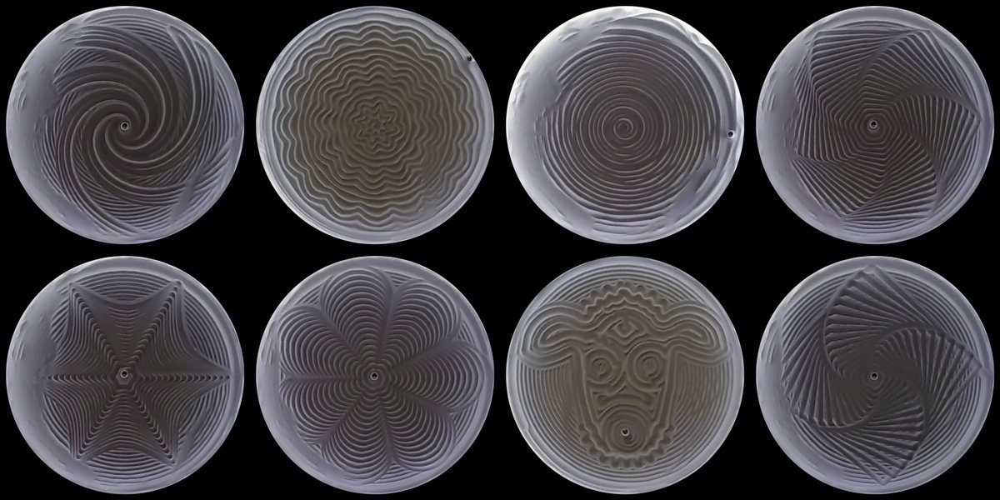
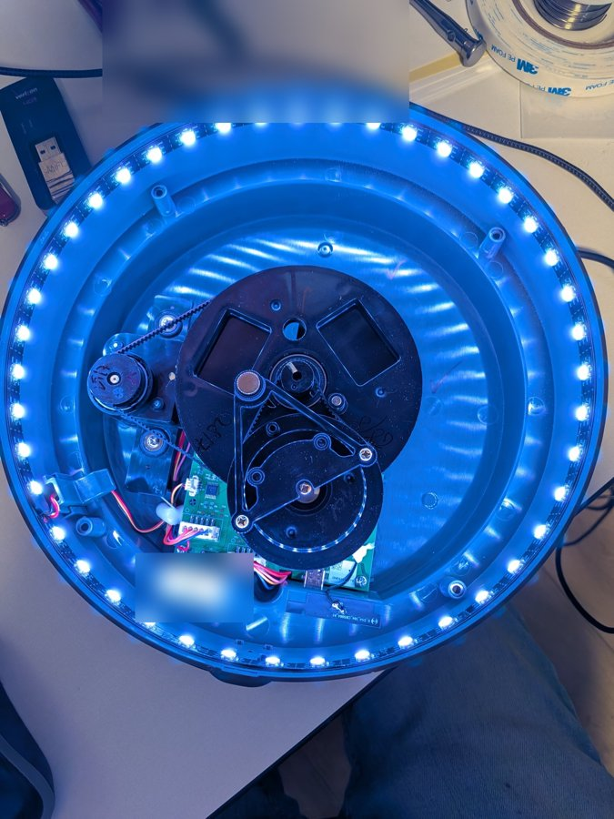
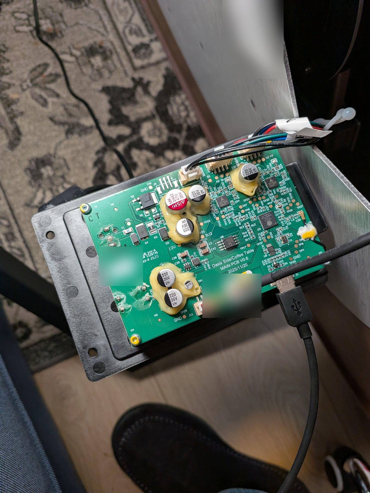

# Oasis sand tables on our own firmware

I have two Oasis sand tables from Grounded Labs: the 9" Mini and the 36" coffee table. If you haven't seen one, there's a magnet under the tray that drags a steel ball around, and the ball leaves lines in the sand. It's really nice to watch.

The problem for me was that to draw anything of your own, you have to go through Grounded's app, make an account and let it talk to their cloud. I didn't want to do any of that, so we replaced their firmware with our own, and that's what this repo is. Both tables are on my home Wi-Fi now, they're controlled from a web page, and neither one ever talks to Grounded.

When I say "we" I mean me and Claude Code. I mostly said what I wanted and judged whether it looked good; Claude wrote pretty much all of the code, ran the experiments and watched the table through a webcam on the laptop. There's a section on how that worked near the end.

This is a hobby project and the repo is a snapshot of where it was at Thanksgiving 2026, so you'll find hard-coded IP addresses and a lot of one-off scripts.

## Contents

- [Where it started](#where-it-started)
- [Getting in without the app](#getting-in-without-the-app)
- [Writing our own firmware for the Mini](#writing-our-own-firmware-for-the-mini)
- [The snap in the middle of the night](#the-snap-in-the-middle-of-the-night)
- [Cutting the cord](#cutting-the-cord)
- [Learning to draw in sand](#learning-to-draw-in-sand)
- [The 36-inch coffee table](#the-36-inch-coffee-table)
- [The Thanksgiving party app](#the-thanksgiving-party-app)
- [How it was built](#how-it-was-built)
- [What's in the repo](#whats-in-the-repo)
- [Trying this yourself](#trying-this-yourself)

## Where it started

The Mini came on November 19. It has an ESP32-S3 inside running Grounded's firmware version 3.16, and the normal setup is to pair it with their phone app over Bluetooth, give it your Wi-Fi password, sign in and pick from their pattern library.

From the start my requirement was that it work with no Grounded app, account or cloud at all. In the last year they've turned off local control in a firmware update, blocked third-party logins, and released a version where tables quit answering remote commands, so I wasn't going to let it anywhere near their servers.

## Getting in without the app

Before it was on any network, we plugged the Mini into the laptop over USB and copied the whole 16 MB flash chip. Secure boot and flash encryption were both off, which made that easy. That copy is how we'd get back to stock if we ever needed to, and it stays on my machine because it has the table's private key in it.

Then we talked to it over Bluetooth. It has one characteristic that you write small JSON commands to, like `{"command":"GETID"}`, and Claude got the rest of the commands by reading through Grounded's Android app. Setting up Wi-Fi is only three messages and doesn't touch the cloud. The scripts for this are in `probes/`.

That got it on my network, but it still wouldn't draw anything. The stock firmware has a local web server, but on 3.16 it's turned off until the table is attached to a Grounded account. We tried patching their firmware four different ways to turn it on; one booted and none of them really worked, and by around 3 pm we decided to stop trying to fix their code.

## Writing our own firmware for the Mini

Our firmware is an Arduino sketch in `firmware/our-fw/`. The first version was on the table around 3:45 that afternoon, and all it did was join Wi-Fi, set the light color and accept a pattern upload (we left the motors off on purpose).

The very first build actually made its own Wi-Fi network instead of joining mine, and when the laptop joined that network to test it, Claude (which runs on the laptop) lost its internet connection and cut itself off. Since then every build joins the house Wi-Fi like a normal device.

Getting it to move took the rest of the night. There's no published pin map for this board, so we worked out every pin ourselves (that's in `firmware-notes/hardware-map.md`) and then figured out the mechanism: two small geared motors and two belts drive an arm with an elbow. One motor swings the whole arm around the center and the other bends the elbow, which is how the magnet can reach anywhere from the center out to the edge.

The gearing came out to whole numbers once we measured it carefully, 2,048 steps per motor turn and a 5:1 belt, so 10,240 steps for the arm to go around once. Our first estimate from the camera was off by 1.2%, which doesn't sound like much, except that it adds up every lap, and after 33 laps the "center" of a drawing was well past the actual center.

After that the firmware kept growing: a planner that looks ahead so curves stay smooth, a queue of jobs, the web page, saved settings and updates over Wi-Fi. The comment block at the top of `our-fw.ino` lists every command.

## The snap in the middle of the night

At 12:08 am the table made a loud snap. I heard it, and so did the laptop's microphone (about 47 dB above the room).

What we found is that the elbow can turn all the way around, but there's a catch inside that only stops it going one way. Coming from one side, the ball stops about 18 mm (3/4") from the center; coming from the other side the arm can be forced through it, and that's what our homing code had been doing every time. That night it finally slipped through with a bang.

I opened up the Mini and took this picture so we could see how the belts and the hub work:

The firmware now has a rule that it never pushes the elbow past the center from the working side, and it homes gently against the solid side of the catch. We also found a sensor that triggers once each time the arm goes around, so the firmware always knows the arm's real angle, and if that pulse comes late it stops the drawing.

About half an hour later I turned the room lights off, which turned out to be a mistake because the camera's auto exposure washed out the sand and the ball tracker started reporting nonsense. We fixed it with manual exposure and the LED ring on a dim warm white.

## Cutting the cord

For the first day the only way Claude knew where the ball was came from the camera. That's fine on my desk, but not for a table that has to run on its own, so the next morning I told it "fyi, when this runs for real, you won't have camera access, so prioritize anything that eliminates our need for the camera." Version 8 came out of that:

- Before each erase the table re-homes the elbow against its stop. The elbow motor has no sensor, so this is how a missed step gets caught.
- The patterns and the control page are stored on the table itself, so you open its address in a browser and tap a picture.
- Firmware updates go over Wi-Fi.
- A short press of the button on the side pauses or resumes.
- There are quiet hours, when it won't start a new drawing and the light stays dim.

The only thing it connects to on the internet is a time server, so it knows when quiet hours are.

## Learning to draw in sand

Moving the ball was the easy part, and making it look good is still in progress.

We started with math patterns like spirals, roses, Lissajous curves and vortexes made of stacked polygons (in `patterns/lib/` and `patterns/gen/`; the photo at the top is some of those in real sand). Then I wanted pictures, starting with our dog Maverick. A line as wide as the ball looks fine, but filling in an area like a face is harder.

Grounded's own showcase pictures look much better than simple line drawings. When I looked closely, "it looks like it kind of carves out each area, going back and forth in fine lines where the width between the lines is very small, and the length of each of those lines is done to make the edges of that section." So we tried that and measured what it does:

- Where the strokes turn around, sand piles up in a ridge about 3-4 mm wide, and that ridge is what you see as the edge of the shape.
- How far apart the strokes are controls the shading. Close together gives a smooth, light area, and farther apart leaves grooves that look darker.
- The ball on the Mini is about 10 mm wide, so anything thinner than that turns into a lump.
- Every time the ball travels from one place to another it leaves a mark, so those moves have to go along edges or through areas that are about to be drawn over.

A test drawing can take half an hour on the table, so there's a sand simulator in `tools/` that was tuned against photos of real drawings and gives an answer in a couple of minutes. The notes we kept as we went are in [`DRAWING-LESSONS.md`](DRAWING-LESSONS.md).

## The 36-inch coffee table

The coffee table arrived November 22. It has the same chip and exactly the same Grounded firmware as the Mini (only the settings are different), but the hardware is completely different.

It uses different motor drivers (TMC2209s, which take step and direction pulses, where the Mini drives each motor coil directly), so putting the Mini's firmware on this board could have spun a motor at full speed. The mechanism is different too: one motor turns the arm and the other moves a carriage in and out along it. And the light ring has 157 LEDs instead of 43.

So we went slowly. First we wrote a "bench" firmware (`firmware/big-bench/`) that does nothing when it boots and only pulses one pin when you ask it to, and used it to measure steps per millimeter, find the home sensor and work out how much current the arm needs so it doesn't skip. Along the way it thumped a few times at the end of the track, which is how we found out where the carriage actually stops. That's all in `firmware-notes/big-qualification.md`. I was also pretty firm about the safety checks; at one point Claude wanted to turn the stall alarm off because it was misfiring, and my answer was "hang on. is it a good idea to turn off the stall alarm? that doesn't sound like a good idea." It got fixed instead.

Then we moved the Mini's drawing code over (`firmware/big-fw/`). The big table now draws out to 385 mm from the center, erases the whole tray with a spiral, and can slowly spin its light ring in whatever color you send it.

## The Thanksgiving party app

The first real use for the coffee table was Thanksgiving, and I wanted the guests to be part of what it drew.

The party app (`sand-app/`) is a small web app on a cloud server. You open it on your phone, enter your name, add a photo and a few interests, and that's it. Then:

- Your photo is turned into a line drawing of your face on the server, using Google's MediaPipe face landmarks and code from `tools/`, sized for a ball that leaves a 10 mm groove.
- Each interest ("guitar", "bacteriophages", "Thailand") turns into a simple line drawing. If Lucide has a matching icon we use that, and if not, Claude draws one.
- The tray is split into a circle in the middle, four inner slices and six outer slices, all the same area. Guests rotate through them and the turns are kept about even.
- Your phone shows a preview of the whole table that looks like real sand, using the same simulator.

The cloud app never connects into my house, which was important to me. A small program at home (`tools/sand_driver.py`) asks the app what to draw next, sends it to the table and reports back, so the table stays off the internet even during the party.

There's no login, only names, because it was built for one family dinner. I'd think twice before giving the link to strangers.

## How it was built

Most of this was done in about a week, and nearly all of the engineering was done by Claude Code running on the laptop next to the table. I'd ask for something (a picture of Maverick, or a table that runs without the laptop) and it would write the code, flash the table, run the drawing and check how it came out.

The webcam was what made that work. It looked down at the Mini and Claude found the ball in every frame, so a command returning OK didn't count unless the ball actually ended up in the right place. It also listened through the laptop microphone for thumps. The rules we gave it were:

- Check the table's status before and after every move, and stop if there's any bang or grinding.
- Never join the table's own Wi-Fi network (see above).
- Prove things on the camera, and write down how each fact was found out.

Later I moved the big table where the camera can't see it, so Claude had to work from the arm sensor, the drivers' stall detection and what I told it, like "you can still push the ball out another 1/2"". That's a big part of why the big table's firmware is so careful.

## What's in the repo

| Folder | What it is |
|---|---|
| `firmware/our-fw/` | Firmware for the Oasis Mini (Arduino, ESP32-S3) |
| `firmware/big-bench/` | Careful bench firmware used to map out the 36-inch board |
| `firmware/big-fw/` | Drawing firmware for the 36-inch table |
| `firmware-notes/` | Pin maps, calibration, the factory-firmware findings, photos |
| `probes/` | Bluetooth scripts used on the stock firmware |
| `web/` | The control and guest pages served by the Mini |
| `patterns/` | Pattern files (`.thr`, one theta-rho point per line) and the scripts that make them |
| `tools/` | Pattern generators, the sand simulator, photo-to-sand converters, flashing and camera scripts |
| `sand-app/` | The Thanksgiving party app (FastAPI, plain JS) and its tests |
| `DRAWING-LESSONS.md` | What we've learned about making drawings look good in real sand |

Patterns are `.thr` files, which is the format most DIY sand tables use: theta in radians and rho from 0 at the center to 1 at the edge.

## Trying this yourself

Please read these first.

1. **Back up the flash before you do anything else.** Over USB: `esptool -p <port> read-flash 0 0x1000000 backup.bin`. It's the only way back to stock, and it has your table's private key in it, so don't share it.
2. **Don't take a Grounded firmware update.** Ours were on 3.16 with secure boot off, and a later version could change that.
3. **The Mini and the 36" need different firmware.** Flashing the wrong one can drive a motor full speed into a stop.
4. Copy `firmware/<name>/wifi_creds.h.example` to `wifi_creds.h` and fill in your 2.4 GHz network.
5. The tools assume the repo is at `~/dev/WillyGarage/oasis`, the Mini is at `10.0.0.204` and the big table is at `10.0.0.149`; change those for your setup.
6. Your table might be a different hardware revision, so measure before you trust any number in here.

We're not affiliated with Grounded Labs, and none of their firmware or patterns are included here. There's no support, and if you break your table, you get to keep both pieces.

### Third-party bits

The face models in `sand-app/server/models/` are Google's MediaPipe models (Apache 2.0). Icons come from [Lucide](https://lucide.dev) (ISC). License files for the bundled browser code sit next to it.
